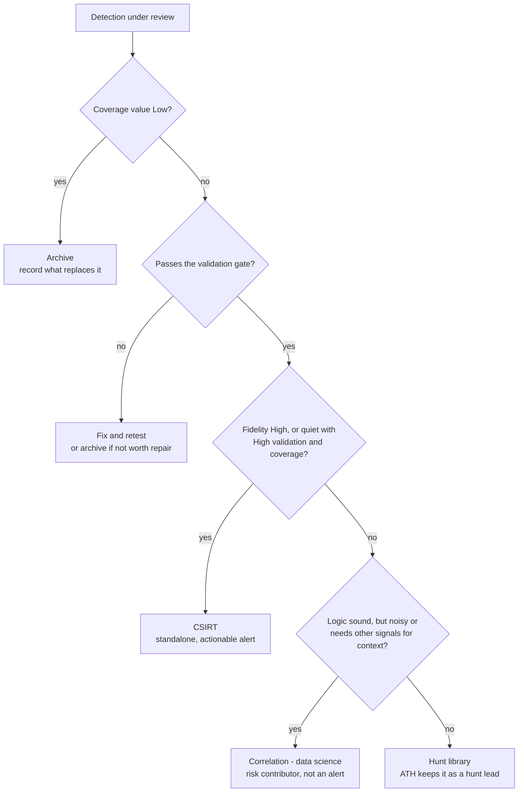

## Purpose and how to use it

Every ATH detection gets three scores and one determination before handoff, recorded in a metadata file beside its `.tf`. Data supplies fidelity and health; the analyst supplies validation confidence and coverage value.

1. Run the ATH Detection Inventory Metrics search (30 days of run stats, 90 days of notable dispositions).
2. Clear the validation gate.
3. Score fidelity, validation confidence and coverage value.
4. Apply the determination rules.
5. Record scores, determination and rationale in the metadata file.
6. Get a second analyst's sign-off on every Archive determination.

## Validation gate

No detection is classified until it passes a function test, except clear archive cases. Zero results over 30 days proves nothing on its own: the detection may be quiet or broken.

A test passes when all four hold:

- **Positive test:** a ground-truth event (emulation or a replayed known-good event) produces a result.
- **Negative control:** normal activity on the same host stays quiet.
- **Clean test host:** the host is not inside a suppression macro or allowlist.
- **Populated fields:** every field the logic depends on is populated in the current sourcetype, not just present.

Skip the gate only when the data source is retired, the CVE is remediated across the estate, or another detection is confirmed to cover the same behavior. Record which one applies.

A failed test means fix and retest, or archive as "broken, not worth repair." A failed detection never goes to CSIRT or data science.

## Scoring inputs

Score three things separately; the determination reads all three, never a blended number.

### Fidelity — does the logic catch what it claims?

From 90 days of notable dispositions. Reviewed = TP + BTP + FP; Undetermined and Other are excluded. The metrics search computes this.

| Level | Criteria |
| --- | --- |
| High | TP at least 50% and FP at most 20% of reviewed |
| Medium | TP + BTP at least 50% (logic is right; activity is often expected) |
| Low | FP above 50% of reviewed |
| Unscored | Fewer than 5 reviewed notables; decide on validation and coverage |

Note bursty firing in the rationale: a single-run max far above the average often means one noisy host or a real event.

### Validation confidence — do we know it works today?

| Level | Criteria |
| --- | --- |
| High | Positive test and negative control passed within 90 days |
| Medium | Positive test only, tests 91–180 days old, or a confirmed TP within 90 days |
| Low | No test on record, or last test older than 180 days |
| Failed | Most recent test did not fire; back to the validation gate |

### Coverage value — what do we lose without it?

| Level | Criteria |
| --- | --- |
| High | Priority technique in current threat intel, or crown-jewel assets, with no equivalent coverage elsewhere |
| Medium | Generic technique, or partial overlap with another detection |
| Low | Duplicated by an EDR-native or other ATH detection, data source retired, or CVE-specific and remediated |

### Confidence score

For sorting only: fidelity points + validation points, where High = 3, Medium = 2, Low or Unscored = 1. Range 2–6; Failed validation scores 0.

## Determination

Work the questions top down; the first yes routes the detection.



Archive comes first because a duplicated or obsolete detection needs no testing. Fidelity only routes detections that are worth keeping and proven to work.

| Determination | Criteria | Handoff package |
| --- | --- | --- |
| CSIRT | Fidelity High, or Unscored with validation and coverage both High; triageable from the notable alone | Triage runbook, known FP and BTP patterns, escalation path, tuning owner |
| Correlation (data science) | Fidelity Medium or Low with real volume, or BTP-dominant; validation Medium or better | Entity fields (user, host, source), base rate, suggested risk weight, ATT&CK mapping |
| Hunt library | Low volume and low fidelity, needs analyst judgment, or an emerging TTP ATH wants to keep | Hunt hypothesis, query, data sources, last hunt date |
| Archive | Coverage Low, or a failed test not worth repair | Reason, replacement coverage, archive date, peer sign-off |

Tie-breakers: between CSIRT and Correlation, pick Correlation to protect the CSIRT queue. Between Correlation and Hunt library, pick Hunt library when triage needs judgment beyond the notable.

## Required metadata per detection

Each detection gets a sidecar YAML file beside its `.tf`; Terraform reads it, so git holds one source of truth that CI can schema-check.

```yaml
savedsearch_name: ATH_<Technique>_<ID>_detection_<n>
attack: [T0000.000]
data_sources: [<sourcetype>]
owner: <analyst>
review_date: YYYY-MM-DD
scores:
  fidelity: High | Medium | Low | Unscored
  fidelity_evidence: {window_days: 90, reviewed: 0, tp: 0, btp: 0, fp: 0}
  validation: High | Medium | Low | Failed
  last_function_test: YYYY-MM-DD
  negative_control: true | false
  coverage_value: High | Medium | Low
  confidence_score: 2-6
determination: CSIRT | Correlation | Hunt library | Archive
rationale: <one or two sentences>
handoff:
  target_team: <team>
  tuning_owner: <team or person>
  handoff_date: YYYY-MM-DD
  return_path: <how it comes back to ATH>
archive:
  reason: <retired source | remediated CVE | duplicate | broken>
  replacement: <detection or control that covers it>
  peer_signoff: <analyst>
```

Terraform loads it with `yamldecode(file("${path.module}/<name>.meta.yaml"))` and writes the determination and scores into the saved search's `description`, so they show in Splunk too.
